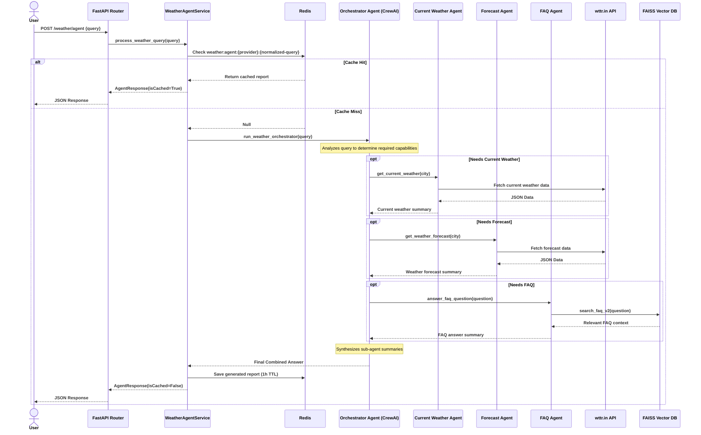

# Weather Assistant API

FastAPI service for current weather data, AI-generated weather summaries, FAQ answers, and MCP tool exposure. Weather data is retrieved from [wttr.in](https://wttr.in), while AI summaries can be generated with CrewAI, LangGraph, AutoGen, or Google ADK.

> **🚀 New Feature: GCP Cloud Run & App Engine Deployment**
> - Application deployment via GCP Cloud Run ([_Note/10_GCP_Deploy_Cloud_Run.md](_Note/10_GCP_Deploy_Cloud_Run.md))
> - Application deployment via GCP App Engine ([_Note/11_GCP_Deply_APP_Engine.md](_Note/11_GCP_Deply_APP_Engine.md))

The API uses Redis as an optional cache and exposes OpenAPI documentation through FastAPI.

## Documentation

- [README-FAQ.md](README-FAQ.md) — FAQ agent and FAISS vector database setup
- [README-MCP.md](README-MCP.md) — Model Context Protocol (MCP) server usage
- [README-TEST.md](README-TEST.md) — testing notes and validation steps
- [_Note/](./_Note) — deployment and operational notes

## Quick Start

1. Create and activate a virtual environment.
2. Install dependencies from `requirements.txt`.
3. Copy `.env.example` to `.env` and add your API keys.
4. Build the FAISS FAQ index if you want the FAQ agent enabled.
5. Start Redis if you want caching enabled.
6. Run the API with `uvicorn` or Docker.

## Features

- Current weather by city
- Weather forecast up to 3 days by city
- AI weather summaries through four agent integrations
- **New:** AI Agent capability resolving application, subscription, and pricing FAQs via an embedded vector database similarity search over `weather.txt`.
- Human-in-the-loop (HITL) weather requests that ask for a missing city and flag consequential bulk-notification requests for approval
- **Model Context Protocol (FastMCP)** server capability
- Redis caching for weather data and generated reports
- Redis-backed session context for HITL clarification and pending approval records
- Health-check endpoint
- Pydantic request and response validation (null fields are excluded from JSON responses)
- Provider-backed output guardrails for current weather and forecast reports, including explicit missing-field disclosures
- AI-generated weather numbers are checked against provider data before responses are cached or returned
- LLM-bound user input is trimmed and limited to 1,000 characters
- CORS support for API clients
- Security headers for HTTP responses
- Structured logging and provider error handling
- Interactive Swagger UI and ReDoc documentation

## Requirements

- Python 3.11 or newer
- Redis 7 or newer for caching
- An OpenAI API key for CrewAI, LangGraph, and AutoGen
- A Google API key for Google ADK
- Langfuse credentials for optional observability
- Docker Desktop, if running Redis or the API container with Docker

## Local Setup

Create and activate a virtual environment:

PowerShell:
```powershell
python -m venv .venv
.\.venv\Scripts\Activate.ps1
python --version
```

Bash/Zsh:
```bash
python -m venv .venv
source .venv/bin/activate
python --version
```

Install the dependencies:

```powershell
python -m pip install --upgrade pip
pip install -r requirements.txt
```

Create the local environment file:

```powershell
Copy-Item .env.example .env
```

The app reads runtime settings from `app/config.py` using Pydantic settings. The `.env` file can contain either uppercase environment variable names or a lower-case `environment` value; the settings loader normalizes them for the application.

Minimal local configuration:

```env
environment=development
OPENAI_API_KEY=your-openai-api-key
OPENAI_API_MODEL=gpt-4o-mini
GOOGLE_API_KEY=your-google-api-key
GOOGLE_ADK_MODEL=gemini-2.0-flash
WEATHER_API_URL=https://wttr.in
WEATHER_TIMEOUT_SECONDS=10
WAQI_API_TOKEN=your-waqi-api-token
REDIS_ENABLED=false
REDIS_URL=redis://localhost:6379/0
REDIS_CACHE_TTL_SECONDS=3600
LANGFUSE_PUBLIC_KEY=your-langfuse-public-key
LANGFUSE_SECRET_KEY=your-langfuse-secret-key
LANGFUSE_BASE_URL=https://cloud.langfuse.com
VECTOR_STORE=faiss
```

Required settings:

- `OPENAI_API_KEY` is required in development and production.
- `WAQI_API_TOKEN` is required only for AQI requests sent through `/api/v1/weather/agent`.
- `GOOGLE_API_KEY` is required in production when the Google ADK path is used.
- `REDIS_URL` is only required when `REDIS_ENABLED=true` and Redis is running remotely.
- `LANGFUSE_PUBLIC_KEY` and `LANGFUSE_SECRET_KEY` are optional; they enable Langfuse telemetry when both are present.


### Langfuse observability

Langfuse tracing is optional. The values above enable tracing when both keys are valid:

```env
LANGFUSE_PUBLIC_KEY=your-langfuse-public-key
LANGFUSE_SECRET_KEY=your-langfuse-secret-key
```

When both keys are configured, the service records the provider, city, cache status, result, and provider errors. If the keys are omitted or Langfuse is unavailable, the API continues without tracing. Obtain keys from your Langfuse project at [langfuse.com](https://langfuse.com/).

## Create Vector DB Index

To enable the AI Agent's FAQ capability, you must build the FAISS vector database index from the provided `weather.txt` FAQ document. This requires your `OPENAI_API_KEY` to be configured in your `.env` file to generate embeddings.

Run the indexing script from the project root:

```powershell
python script/build_faiss_index.py
```

This script reads `data/faq/weather.txt`, splits the text, creates embeddings using OpenAI, and saves the resulting FAISS index to the `data/faiss_index` directory. The application will load this index automatically to answer application, subscription, and pricing FAQs.


## Start Redis

The Compose file starts Redis only:

```powershell
docker compose up -d redis
```

Stop Redis when it is no longer needed:

```powershell
docker compose down
```

The API can also run without Redis. In that case, requests bypass the cache and call the upstream weather or agent provider directly. The HITL endpoint depends on Redis to store session context and pending approval records, so enable Redis when using that endpoint.

The application shares one `AsyncRedisCache` Singleton instance across its services and
orchestrators. It creates the Redis client once when caching is enabled; when
caching is disabled, cache reads return no result and writes are skipped.

## Run the API

Start the main API from the project root:

```powershell
uvicorn app.main:app --reload
```

For local App Engine testing, you can set the environment variables before starting the app:

```powershell
$env:ENVIRONMENT = "production"
$env:GOOGLE_CLOUD_PROJECT = "workspace-prod-511311"
$env:DEPLOY_TYPE = "app-engine"
uvicorn app.main:app --reload
```

Alternatively:

```powershell
python app/main.py
```

The API is available at `http://localhost:8000`.

Documentation:

- Swagger UI: `http://localhost:8000/docs`
- ReDoc: `http://localhost:8000/redoc`

For the MCP server, see [README-MCP.md](README-MCP.md):

```powershell
uvicorn app.weather-mcp:app --host 0.0.0.0 --port 8100 --reload
```

## Run with Docker

Build the image:

```powershell
docker build -t weather-assistant-api .
```

Run the API using the local environment file:

```powershell
docker run --rm --env-file .env -p 8000:8000 weather-assistant-api
```

When the API runs inside a container, `REDIS_URL` must point to a Redis host reachable from that container. For example, use `redis` when both services run on the same Docker network.

## Run Tests

Run the complete test suite from the project root:

```powershell
python -m pytest tests/ -v
```

## Output guardrails

Current conditions and forecast rows are validated against Pydantic models.
Unavailable provider fields are returned in each weather record's
`unavailable_fields` list rather than being filled with guessed values.
Generated current-weather and CrewAI forecast reports include the underlying
provider data, and numeric weather claims that do not match that data are
rejected before caching or returning the report. Responses also enforce the
application's output schema, message-size limit, and credential-like content
policy.


The project pins AutoGen `0.7.5` and Langfuse `4.15.6` in `requirements.txt`.

## API Endpoints

All application endpoints use the `/api/v1` prefix. The `city` query parameter is required for weather endpoints.

### Health check

```http
GET /api/v1/health
```

Response:

```json
{
  "status": "ok"
}
```

### Current weather

```http
GET /api/v1/weather?city=Delhi
```

PowerShell:

```powershell
Invoke-RestMethod "http://localhost:8000/api/v1/weather?city=Delhi"
```

Example response for a fresh request:

```json
{
  "status": "success",
  "data": {
    "city": "Delhi",
    "temperature": "25",
    "feels_like": "26",
    "humidity": "60",
    "description": "Sunny",
    "wind_speed": "10"
  },
  "isCached": false
}
```

### Weather Forecast

```http
GET /api/v1/weather/forecast?city=Delhi
```

PowerShell:

```powershell
Invoke-RestMethod "http://localhost:8000/api/v1/weather/forecast?city=Delhi"
```

Example response:

```json
{
  "status": "success",
  "data": [
    {
      "date": "2026-09-26",
      "max_temp_c": "34",
      "min_temp_c": "25",
      "avg_temp_c": "29",
      "condition": "Sunny",
      "humidity": "50",
      "wind_speed_kmph": "12",
      "chance_of_rain": "0",
      "chance_of_snow": "0",
      "uv_index": "7"
    },
    {
      "date": "2026-09-27",
      "max_temp_c": "33",
      "min_temp_c": "24",
      "avg_temp_c": "28",
      "condition": "Partly cloudy",
      "humidity": "55",
      "wind_speed_kmph": "15",
      "chance_of_rain": "10",
      "chance_of_snow": "0",
      "uv_index": "6"
    }
  ],
  "isCached": false
}
```


### AI Weather Summaries

For intelligent, natural-language weather requests, the recommended approach is using the robust multi-agent POST endpoint. This endpoint uses an orchestrator to route requests to the current-weather, forecast, air-quality (WAQI), and FAQ specialist agents as needed:

```http
POST /api/v1/weather/agent
Content-Type: application/json

{
  "query": "What is the current weather and 3-day forecast for London?",
  "session_id": "weather-session-123"
}
```

For air quality, configure `WAQI_API_TOKEN` in `.env` (or as a deployment environment variable) and ask, for example:

```json
{
  "query": "What is the current AQI and pollution level in Delhi?",
  "session_id": "weather-session-123"
}
```

The CrewAI endpoint requires a `session_id` of at least six characters. Reuse the same ID to retain session context.

The legacy GET endpoints are also available and return similar schemas:

```http
GET /api/v1/weather/crewai?city=What is the weather of Delhi
GET /api/v1/weather/langgraph?city=What is the temp of Delhi
GET /api/v1/weather/autogen?city=tell me weather of Delhi
```

PowerShell example (CrewAI):

```powershell
Invoke-RestMethod "http://localhost:8000/api/v1/weather/agent" `
  -Method Post `
  -ContentType "application/json" `
  -Body '{"query":"What is the weather forecast for Delhi today and the upcoming days? Is this service free to use?","session_id":"weather-session-123"}'
```

PowerShell example (LangGraph):

```powershell
Invoke-RestMethod "http://localhost:8000/api/v1/weather/agent/langgraph" `
  -Method Post `
  -ContentType "application/json" `
  -Body '{"query":"What is the weather forecast for Delhi today and the upcoming days? Is this service free to use?"}'
```

### Human-in-the-loop requests

Use `POST /api/v1/weather/agent/hitl` for requests that may need clarification or human approval. AQI and air-pollution questions are handled by the WAQI specialist; configure `WAQI_API_TOKEN` in `.env` and send the city in the query. Configure Redis first and send a `query` plus a `session_id` with at least six characters. Reuse the session ID when answering a clarification:

```powershell
Invoke-RestMethod "http://localhost:8000/api/v1/weather/agent/hitl" `
  -Method Post `
  -ContentType "application/json" `
  -Body '{"query":"What is the AQI for Noida?","session_id":"weather-session-123"}'
```

When the query does not identify a city and the session has no previously resolved city, the response has `"status": "pending_clarification"` and asks which city to use. Send the city in a follow-up query using the same session ID.

Requests to perform a recognized consequential action, such as broadcasting an alert to all users, return `"status": "pending_approval"` and a `data.approval_id`. The approval record expires after one hour. This API currently creates the pending record but does not expose an endpoint to approve, reject, or execute the action.

Example response:

```json
{
    "status": "success",
    "message": "The weather forecast for Delhi today and the upcoming days is as follows:

            - October 17, 2026: Max Temperature 34°C, Min Temperature 26°C, Sunny
            - October 18, 2026: Max Temperature 34°C, Min Temperature 26°C, Sunny
            - October 19, 2026: Max Temperature 35°C, Min Temperature 26°C, Sunny
            
            Regarding the service usage, the Weather Demo application can be developed and demonstrated for free using the publicly accessible `wttr.in` service. However, while the weather-data request itself may not require a conventional API subscription, there could still be infrastructure costs associated with your particular application setup.
            "
  }
```

Agent report cache keys include the provider and a normalized query. Query text
is case-folded, and runs of non-alphanumeric characters (including spaces and
punctuation) become a single hyphen. For example,
`Delhi upcoming weather for 10 days` produces
`weather:agent:crewai:delhi-upcoming-weather-for-10-days`. Repeated requests
that normalize to the same provider/query key return `"isCached": true`.

### Multi-Agent Orchestration Flow

The POST endpoint (`/weather/agent`) introduces an intelligent **CrewAI Orchestrator** that parses complex natural language queries and delegates work to specialized sub-agents. Here is the flow:



## Error Responses

- `404`: the weather provider could not find the requested city
- `422`: the `city` query parameter is missing or invalid
- `502`: the weather or AI provider is unavailable
- `500`: an unexpected application error occurred

Provider failures are logged and returned as safe API responses instead of exposing internal exceptions.
## Security

The API implements several HTTP security headers to protect against common web vulnerabilities:

- **Strict-Transport-Security (HSTS)**: Enforces secure (HTTPS) connections to the server (`max-age=31536000; includeSubDomains`).
- **X-Content-Type-Options**: Prevents the browser from interpreting files as a different MIME type to what is specified (`nosniff`).
- **X-Frame-Options**: Protects against clickjacking by denying the rendering of the API in a frame (`DENY`).
- **Content-Security-Policy (CSP)**: Helps detect and mitigate certain types of attacks, including Cross-Site Scripting (XSS) and data injection attacks (`default-src 'self'`).
- **Referrer-Policy**: Controls how much referrer information should be included with requests (`strict-origin-when-cross-origin`).

CORS is also configured to allow cross-origin requests. This can be restricted in production by configuring the `allow_origins` settings in `app/main.py`.


## Project Structure

```text
app/
├── cache/               # Shared Redis cache
├── agents/              # CrewAI, LangGraph, AutoGen, and Google ADK agents
├── orchestrator/        # CrewAI and LangGraph multi-agent orchestrators
├── route/               # FastAPI route handlers
├── schema/              # Pydantic request and response models
├── services/            # Weather service and service interface
├── tools/               # Agent weather tools
├── config.py            # Environment-backed settings
├── main.py              # FastAPI application
├── weather-mcp.py       # FastMCP server configuration
└── utils/               # Logging and response helpers
data/                    # Data directory for vector DB, FAQ documents, and prompts
script/                  # Helper and test scripts (e.g., FAISS index builder)
helm-config/             # Kubernetes Helm chart for Application
helm-mcp/                # Kubernetes Helm chart for FastMCP
tests/                   # API and service tests
app.yaml                 # GCP App Engine configuration
deploy.sh                # GCP Cloud Run deployment script
```

## Kubernetes

The `helm-config` directory contains the Helm chart for deploying the API. It requires `OPENAI_API_KEY`, `GOOGLE_API_KEY`, and `REDIS_URL` as environment variables. Configure those values through your cluster's secret management before deploying.

Update the image repository, tag, ingress host, and resource settings in `helm-config/values.yaml` before deploying:

```powershell
helm upgrade --install weather-agent .\helm-config
```
